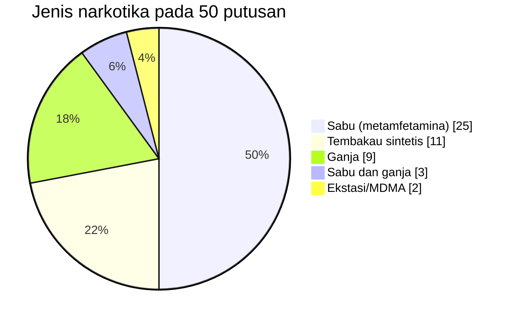

<h1 align="center">Dataset-Narkotika_449_486</h1>

<p align="center">
  Dataset 50 putusan pidana khusus <b>Narkotika dan Psikotropika</b> Pengadilan Negeri Bekasi tahun 2025,<br/>
  diambil dari Direktori Putusan Mahkamah Agung Republik Indonesia untuk riset Temu Kembali Informasi.
</p>

<p align="center">
  
  
  
  
  
  
</p>

---

## Daftar Isi

- [Sekilas](#sekilas)
- [Anggota Kelompok](#anggota-kelompok)
- [Struktur Repositori](#struktur-repositori)
- [Web Showcase](#web-showcase)
- [Mulai Cepat](#mulai-cepat)
- [Isi Overview.xlsx](#isi-overviewxlsx)
- [Statistik Dataset](#statistik-dataset)
- [Metodologi Akuisisi](#metodologi-akuisisi)
- [Kualitas Data dan Batasan](#kualitas-data-dan-batasan)
- [Daftar Putusan](#daftar-putusan)
- [Sitasi](#sitasi)
- [Lisensi dan Atribusi](#lisensi-dan-atribusi)
- [Riwayat Perubahan](#riwayat-perubahan)

## Sekilas

| Atribut | Nilai |
|---|---|
| Sumber | [Direktori Putusan Mahkamah Agung RI](https://putusan3.mahkamahagung.go.id/direktori.html) |
| Direktori | Pidana Khusus › Narkotika dan Psikotropika |
| Lembaga peradilan | Pengadilan Negeri Bekasi (kode `PN Bks`) |
| Tahun register perkara | 2025 (nomor perkara 107 sampai 609) |
| Rentang tanggal dibacakan | 19 Mei 2025 sampai 19 Januari 2026 |
| Jumlah dokumen | 50 PDF, 1.758 halaman (18 sampai 165 halaman per putusan, median 29) |
| Ukuran | `Narkotika.zip` 20,5 MB (isi 24,9 MB) |
| Tanggal akses | 30 Oktober 2026 |
| Tugas | UTS Temu Kembali Informasi, Soal Tugas 2, Semester Ganjil 2026/2027 |

## Anggota Kelompok

| No | Nama | NIM |
|---:|---|---|
| 1 | Widya Kusuma | 202310370311449 |
| 2 | Farhan Kurnia Febriansyah | 202310370311486 |

Nama repositori mengikuti ketentuan `Dataset-Narkotika_<3 digit NIM anggota 1>_<3 digit NIM anggota 2>`.

## Struktur Repositori

```text
Dataset-Narkotika_449_486/
├── Dataset/
│   └── Narkotika.zip      # 50 PDF putusan, nama file: <nomor>_Pid.Sus_<tahun>_PN Bks.pdf
├── Overview/
│   └── Overview.xlsx      # Ringkasan 50 putusan (3 sheet)
├── notebooks/             # Notebook Soal 3 dan 4 beserta panduannya
├── web/                   # Showcase interaktif di browser
├── docs/                  # Laporan Soal 1 dan panduan relay
└── README.md
```

Nama file PDF diturunkan dari nomor putusan dengan mengganti `/` menjadi `_`. Contoh: `107/Pid.Sus/2025/PN Bks` disimpan sebagai `107_Pid.Sus_2025_PN Bks.pdf`.

### Berkas Lain di Repositori

| Soal | Berkas |
|---|---|
| 1 | [docs/state_of_the_art.pdf](docs/state_of_the_art.pdf) |
| 3 dan 4 | [notebooks/](notebooks/README.md), memakai dataset ini sebagai cadangan crawl, korpus, dan ground truth |

## Web Showcase

[Web showcase](web/) menyajikan sembilan tahap temu kembali informasi, dari crawl hingga evaluasi, termasuk pencarian dengan sorotan hasil pada PDF. Seluruh pemrosesan berjalan di browser pengunjung, tanpa server pemrosesan.

- **Jalankan lokal** (Node.js 22): `cd web`, `npm ci`, lalu `npm run dev`.
- **Uji paritas** dengan notebook: jalankan `uv sync` dari akar repositori untuk menyiapkan oracle Python, lalu `cd web` dan `npm run test:parity`. Saat ini pemanggilan oracle memakai Python di `.venv/Scripts/python.exe` (Windows).
- **Deploy**: [workflow Pages](.github/workflows/pages.yml) menjalankan pemeriksaan dan build, lalu menerbitkan `web/dist` saat perubahan `web/**`, `Dataset/**`, atau workflow masuk ke `main`; tersedia juga pemicu manual. Aktifkan **Settings → Pages → Source: GitHub Actions**. Uji paritas dijalankan terpisah dari deploy.
- **Kredit**: dataset putusan kelompok ini dari Mahkamah Agung RI; pdf.js; Tesseract.js dengan model `tessdata_fast`; serta SastrawiJs dengan kamus Kateglo berlisensi **CC-BY-NC-SA 3.0**.

## Mulai Cepat

Unduh dataset langsung di Python atau Google Colab:

```python
import io, zipfile, urllib.request
import pandas as pd

REPO = "https://github.com/Kumareze/Dataset-Narkotika_449_486/raw/main"

# 1. Ringkasan putusan
overview = pd.read_excel(f"{REPO}/Overview/Overview.xlsx", sheet_name="Overview")
metadata = pd.read_excel(f"{REPO}/Overview/Overview.xlsx", sheet_name="Metadata")
print(overview.head())

# 2. Dokumen PDF
data = urllib.request.urlopen(f"{REPO}/Dataset/Narkotika.zip").read()
zipfile.ZipFile(io.BytesIO(data)).extractall("putusan_pdf")
```

Membaca teks satu putusan:

```python
from pypdf import PdfReader
reader = PdfReader("putusan_pdf/107_Pid.Sus_2025_PN Bks.pdf")
text = "\n".join(page.extract_text() or "" for page in reader.pages)
```

Contoh analisis cepat:

```python
metadata.groupby("Jenis Narkotika")["Pidana Penjara (bulan)"].describe()
overview[overview["Barang Bukti"].str.contains("ganja", case=False)]
```

## Isi Overview.xlsx

### Sheet `Overview` (format wajib tugas)

| Kolom | Tipe | Keterangan |
|---|---|---|
| `No` | int | Nomor urut, diurutkan berdasarkan nomor perkara |
| `No Putusan` | teks | Nomor register, format `<nomor>/Pid.Sus/<tahun>/PN Bks` |
| `Lembaga Peradilan` | teks | `PN Bekasi` |
| `Barang Bukti` | teks | Daftar barang bukti dari amar putusan, satu item per baris diakhiri `;` |
| `Amar Putusan` | teks | Seluruh diktum amar (bagian MENGADILI), satu diktum per baris |

Contoh baris (dipotong):

| No | No Putusan | Lembaga Peradilan | Barang Bukti | Amar Putusan |
|---:|---|---|---|---|
| 1 | 107/Pid.Sus/2025/PN Bks | PN Bekasi | 1 (Satu) Unit Hand Phone Redmi Note 12 ...;<br/>Kode A.1: 1 (Satu) Bungkus plastik bening berisikan 50 (Lima Puluh) Butir Tablet ... berat brutto 19,93 gram ...; | Menyatakan Terdakwa IWAN SUCIANTO Bin TAMAN SUCIPTO (Alm) telah terbukti secara sah ...;<br/>Menjatuhkan pidana ... penjara selama 11 (sebelas) tahun dan denda sebesar Rp.1.000.000.000,00 ...; |

### Sheet `Metadata` (turunan dari amar)

| Kolom | Keterangan |
|---|---|
| `Nomor Perkara`, `Tahun` | Komponen nomor putusan |
| `Jenis Narkotika` | Sabu (metamfetamina), Ganja, Tembakau sintetis, Ekstasi/MDMA |
| `Pidana Penjara (bulan)` | Pidana penjara pokok dalam bulan |
| `Denda (Rp)` | Pidana denda dalam rupiah |
| `Subsider Denda (bulan)` | Pidana pengganti apabila denda tidak dibayar |
| `Rehabilitasi` | `Ya` jika amar memuat perintah rehabilitasi |
| `Jumlah Terdakwa` | Jumlah terdakwa dalam satu putusan |
| `Tanggal Musyawarah`, `Tanggal Dibacakan` | Tanggal dari metadata halaman putusan |
| `File PDF` | Nama file di dalam `Narkotika.zip` |
| `Tanggal Register`, `Tingkat Proses` | Dari halaman detail Direktori Putusan |
| `Status Hukum` | Hasil pengecekan status Berkekuatan Hukum Tetap pada halaman detail |
| `URL Putusan`, `URL PDF` | Halaman detail dan tautan unduh resmi |

### Sheet `Keterangan`

Kamus data untuk seluruh kolom di dua sheet sebelumnya.

## Statistik Dataset

### Jenis Narkotika



| Jenis narkotika | Putusan | Rata-rata pidana | Rentang pidana |
|---|---:|---:|---|
| Sabu (metamfetamina) | 25 | 7,4 tahun | 6 sampai 10 tahun |
| Tembakau sintetis | 11 | 7,3 tahun | 5,5 sampai 9 tahun |
| Ganja | 9 | 8,2 tahun | 6 sampai 17 tahun |
| Sabu dan ganja | 3 | 8,0 tahun | 7 sampai 9 tahun |
| Ekstasi/MDMA | 2 | 11 tahun (1 putusan terbaca) | 11 tahun |

### Pidana

| Lama pidana penjara | Putusan |
|---|---:|
| 5,5 sampai 7 tahun | 31 |
| lebih dari 7 sampai 9 tahun | 15 |
| lebih dari 9 sampai 12 tahun | 2 |
| lebih dari 12 tahun | 1 |
| tidak terbaca otomatis | 1 |

- Median pidana penjara 7 tahun, rata-rata 7,6 tahun, maksimum 17 tahun (`288/Pid.Sus/2025/PN Bks`, ganja lebih dari 1 kg, dua terdakwa).
- Denda Rp1 miliar pada 49 putusan dan Rp2 miliar pada 1 putusan; subsider denda 1 sampai 6 bulan.
- 46 putusan dengan satu terdakwa dan 4 putusan dengan dua terdakwa. Tidak ada putusan rehabilitasi.

### Sebaran Waktu Putusan Dibacakan

| Bulan | Mei 2025 | Jun | Jul | Agu | Sep | Okt | Jan 2026 |
|---|---:|---:|---:|---:|---:|---:|---:|
| Putusan | 6 | 3 | 3 | 10 | 15 | 10 | 3 |

## Metodologi Akuisisi

1. Buka [Direktori Putusan](https://putusan3.mahkamahagung.go.id/direktori.html), pilih **Pidana Khusus › Narkotika dan Psikotropika**.
2. Saring lembaga peradilan **PN Bekasi** dan tahun **2025**.
3. Buka halaman detail setiap putusan, catat nomor, amar, dan tanggal, lalu unduh lampiran PDF.
4. Simpan PDF dengan nama `<nomor>_Pid.Sus_<tahun>_PN Bks.pdf`, lalu kemas ke `Dataset/Narkotika.zip`.
5. Susun `Overview.xlsx` dari amar putusan, lalu bersihkan (lihat bagian berikut).

Kriteria seleksi mengikuti ketentuan tugas:

- Direktori Pidana Khusus, klasifikasi Narkotika dan Psikotropika.
- Satu Pengadilan Negeri (PN Bekasi), tidak dipakai kelompok lain.
- Tahun putusan dalam rentang 2023 sampai 2025.
- Putusan tidak berstatus **Berkekuatan Hukum Tetap**.

Verifikasi ulang pada 11 November 2026 terhadap halaman detail ke-50 putusan:

| Pemeriksaan | Hasil |
|---|---|
| Tingkat Proses | `Pertama` pada 50 putusan |
| Klasifikasi | `Pidana Khusus › Narkotika dan Psikotropika` pada 50 putusan |
| Lembaga Peradilan | `PN BEKASI` pada 50 putusan |
| Teks "Berkekuatan Hukum Tetap" | Tidak ditemukan pada 50 halaman detail |
| Tautan PDF resmi | Tersedia pada 50 putusan, dicatat di sheet `Metadata` (`URL Putusan`, `URL PDF`) |

URL daftar yang dipakai: `https://putusan3.mahkamahagung.go.id/direktori/index/pengadilan/pn-bekasi/kategori/narkotika-dan-psikotropika-1/tahunjenis/regis/tahun/2025.html` (halaman 1 sampai 11, 20 putusan per halaman).

Etika akses: halaman dibuka satu per satu dengan jeda, tanpa akses paralel. `robots.txt` situs mengizinkan `User-agent: *` dengan sinyal konten `search=yes, ai-train=no, use=reference`, sehingga dataset ini hanya dipakai sebagai rujukan akademik dan tidak dipakai untuk melatih model AI. Crawler otomatis untuk direktori yang sama tersedia pada [notebook Soal 3](notebooks/README.md).

### Pembersihan Overview.xlsx

| Masalah pada data mentah | Perbaikan |
|---|---|
| Angka desimal terpecah, misalnya `19, 93 gram` | Digabung menjadi `19,93` hanya jika bentuk tanpa spasi ada di PDF sumber (657 perbaikan) |
| Sisa awalan kalimat, misalnya `yang diajukan ke persidangan ini berupa;` | Dihapus dari awal kolom Barang Bukti |
| Tanggal musyawarah dan dibacakan menempel di akhir amar | Dipindah ke sheet `Metadata` |
| Judul `M E N G A D I L I` dan penomoran `1.;` | Dihapus, setiap diktum ditulis pada baris sendiri |
| Urutan baris acak | Diurutkan berdasarkan nomor perkara |

## Kualitas Data dan Batasan

- `392/Pid.Sus/2025/PN Bks` adalah PDF hasil pindai tanpa lapisan teks. Teksnya perlu OCR ([notebook Soal 3 dan 4](notebooks/README.md) menjalankan Tesseract secara otomatis).
- Salah ketik berasal dari dokumen sumber dan dipertahankan apa adanya, misalnya `wama` (warna), `meyakinan`, atau nominal `Rp 1.000.000,000, 00`.
- Sebagian kata menempel pada teks sumber, misalnya `TerdakwaRama` dan `beratnetto`.
- Pidana penjara `412/Pid.Sus/2025/PN Bks` tertulis tanpa satuan ("selama 5 (lima) dan ...") sehingga kolom bulan dibiarkan kosong.
- PDF `123/Pid.Sus/2025/PN Bks` memuat titik-titik pada lama pidana ("pidana penjara selama ........"), sedangkan metadata situs mencatat 7 tahun.
- Judul PDF `261/Pid.Sus/2025/PN Bks` tertulis `261/Pid.Sus/2024/PN Bks`, sedangkan seluruh footer halaman dan metadata situs memakai tahun 2025.
- Kolom `Metadata` diturunkan secara otomatis dengan pola teks. Periksa kembali ke PDF sebelum dipakai sebagai ground truth.
- Status hukum dapat berubah setelah tanggal akses. Periksa status terkini langsung di situs Mahkamah Agung.
- Data pribadi terdakwa (nama, alamat, nomor telepon pada barang bukti) berasal dari dokumen publik. Gunakan hanya untuk kepentingan akademik dan jangan menyebarkannya di luar konteks tersebut.

## Daftar Putusan

<details>
<summary>Tampilkan 50 putusan</summary>

| No | No Putusan | Jenis Narkotika | Pidana Penjara | Denda | Dibacakan | Hlm | Ukuran |
|---:|---|---|---|---|---|---:|---:|
| 1 | [`107/Pid.Sus/2025/PN Bks`](https://putusan3.mahkamahagung.go.id/direktori/putusan/zaf15595a0fe1f4a9396313132303536.html) | Ekstasi/MDMA | 11 th | Rp1 miliar | 19 Mei 2025 | 56 | 470 KB |
| 2 | [`123/Pid.Sus/2025/PN Bks`](https://putusan3.mahkamahagung.go.id/direktori/putusan/zaf155931e4ab40caed9313130323538.html) | Sabu (metamfetamina) | 7 th | Rp1 miliar | 21 Mei 2025 | 18 | 147 KB |
| 3 | [`125/Pid.Sus/2025/PN Bks`](https://putusan3.mahkamahagung.go.id/direktori/putusan/zaf155932561c0a0aec5313130333130.html) | Sabu (metamfetamina) | 7 th | Rp1 miliar | 21 Mei 2025 | 56 | 351 KB |
| 4 | [`126/Pid.Sus/2025/PN Bks`](https://putusan3.mahkamahagung.go.id/direktori/putusan/zaf1559323d1769088b6313130333037.html) | Sabu (metamfetamina) | 7 th | Rp1 miliar | 21 Mei 2025 | 55 | 329 KB |
| 5 | [`127/Pid.Sus/2025/PN Bks`](https://putusan3.mahkamahagung.go.id/direktori/putusan/zaf15593207a2ee289a9313130333031.html) | Sabu (metamfetamina) | 7 th | Rp1 miliar | 21 Mei 2025 | 66 | 551 KB |
| 6 | [`128/Pid.Sus/2025/PN Bks`](https://putusan3.mahkamahagung.go.id/direktori/putusan/zaf155931caa4e96964e313130323535.html) | Sabu (metamfetamina), Ganja | 8 th | Rp1 miliar | 21 Mei 2025 | 23 | 164 KB |
| 7 | [`131/Pid.Sus/2025/PN Bks`](https://putusan3.mahkamahagung.go.id/direktori/putusan/zaf14ac64f5491628236313731313432.html) | Ganja | 8 th | Rp1 miliar | 18 Juni 2025 | 22 | 170 KB |
| 8 | [`154/Pid.Sus/2025/PN Bks`](https://putusan3.mahkamahagung.go.id/direktori/putusan/zaf14ac651d716bc8939313731313436.html) | Sabu (metamfetamina) | 9 th | Rp1 miliar | 18 Juni 2025 | 27 | 182 KB |
| 9 | [`163/Pid.Sus/2025/PN Bks`](https://putusan3.mahkamahagung.go.id/direktori/putusan/zaf14ac5a06dd118ba8c313730363438.html) | Tembakau sintetis | 8 th 6 bln | Rp1 miliar | 30 Juni 2025 | 21 | 228 KB |
| 10 | [`200/Pid.Sus/2025/PN Bks`](https://putusan3.mahkamahagung.go.id/direktori/putusan/zaf14abf5f000b5caacd313632323031.html) | Ganja | 7 th | Rp1 miliar | 23 Juli 2025 | 29 | 217 KB |
| 11 | [`208/Pid.Sus/2025/PN Bks`](https://putusan3.mahkamahagung.go.id/direktori/putusan/zaf14abf606b5d029f71313632323034.html) | Ganja | 6 th | Rp1 miliar | 23 Juli 2025 | 26 | 175 KB |
| 12 | [`209/Pid.Sus/2025/PN Bks`](https://putusan3.mahkamahagung.go.id/direktori/putusan/zaf14abf63c227108839313632323039.html) | Ganja | 6 th | Rp1 miliar | 23 Juli 2025 | 32 | 299 KB |
| 13 | [`232/Pid.Sus/2025/PN Bks`](https://putusan3.mahkamahagung.go.id/direktori/putusan/zaf14ab1c88e3bb0bd47313434343435.html) | Tembakau sintetis | 7 th | Rp1 miliar | 25 Agustus 2025 | 56 | 317 KB |
| 14 | [`233/Pid.Sus/2025/PN Bks`](https://putusan3.mahkamahagung.go.id/direktori/putusan/zaf14ab8b474f248a185313533343138.html) | Sabu (metamfetamina) | 7 th | Rp1 miliar | 20 Agustus 2025 | 32 | 232 KB |
| 15 | [`243/Pid.Sus/2025/PN Bks`](https://putusan3.mahkamahagung.go.id/direktori/putusan/zaf14abe2a317a7e97ce313631333233.html) | Tembakau sintetis | 7 th | Rp1 miliar | 13 Agustus 2025 | 21 | 163 KB |
| 16 | [`248/Pid.Sus/2025/PN Bks`](https://putusan3.mahkamahagung.go.id/direktori/putusan/zaf14ab1954e17d4b7fd313434333139.html) | Sabu (metamfetamina) | 7 th | Rp1 miliar | 27 Agustus 2025 | 19 | 162 KB |
| 17 | [`250/Pid.Sus/2025/PN Bks`](https://putusan3.mahkamahagung.go.id/direktori/putusan/zaf14aaa7d687d8c98fb313335323333.html) | Tembakau sintetis | 8 th | Rp1 miliar | 15 September 2025 | 49 | 394 KB |
| 18 | [`261/Pid.Sus/2025/PN Bks`](https://putusan3.mahkamahagung.go.id/direktori/putusan/zaf14ab193982cc29693313434333137.html) | Tembakau sintetis | 7 th | Rp1 miliar | 27 Agustus 2025 | 19 | 359 KB |
| 19 | [`263/Pid.Sus/2025/PN Bks`](https://putusan3.mahkamahagung.go.id/direktori/putusan/zaf14aaf9248a4b6b520313432383535.html) | Sabu (metamfetamina) | 10 th | Rp1 miliar | 3 September 2025 | 31 | 206 KB |
| 20 | [`264/Pid.Sus/2025/PN Bks`](https://putusan3.mahkamahagung.go.id/direktori/putusan/zaf14aaf90f8c3a2b296313432383533.html) | Sabu (metamfetamina) | 9 th | Rp1 miliar | 3 September 2025 | 34 | 221 KB |
| 21 | [`265/Pid.Sus/2025/PN Bks`](https://putusan3.mahkamahagung.go.id/direktori/putusan/zaf14aaf8f8d1ff4b855313432383531.html) | Sabu (metamfetamina) | 9 th | Rp1 miliar | 3 September 2025 | 38 | 222 KB |
| 22 | [`266/Pid.Sus/2025/PN Bks`](https://putusan3.mahkamahagung.go.id/direktori/putusan/zaf14aaf8cd6d23c9ae1313432383436.html) | Sabu (metamfetamina) | 9 th | Rp1 miliar | 3 September 2025 | 38 | 221 KB |
| 23 | [`281/Pid.Sus/2025/PN Bks`](https://putusan3.mahkamahagung.go.id/direktori/putusan/zaf14aaa54397a4c90f7313335313234.html) | Sabu (metamfetamina) | 8 th | Rp1 miliar | 17 September 2025 | 60 | 337 KB |
| 24 | [`282/Pid.Sus/2025/PN Bks`](https://putusan3.mahkamahagung.go.id/direktori/putusan/zaf14aaa525ca96a8dde313335313231.html) | Sabu (metamfetamina) | 8 th | Rp1 miliar | 17 September 2025 | 53 | 319 KB |
| 25 | [`283/Pid.Sus/2025/PN Bks`](https://putusan3.mahkamahagung.go.id/direktori/putusan/zaf14ab19ffc0f748584313434333337.html) | Ganja | 7 th | Rp1 miliar | 27 Agustus 2025 | 21 | 222 KB |
| 26 | [`284/Pid.Sus/2025/PN Bks`](https://putusan3.mahkamahagung.go.id/direktori/putusan/zaf14ab19dde00dabfeb313434333334.html) | Ganja | 7 th | Rp1 miliar | 27 Agustus 2025 | 21 | 225 KB |
| 27 | [`285/Pid.Sus/2025/PN Bks`](https://putusan3.mahkamahagung.go.id/direktori/putusan/zaf14aa9dfa3e5b4acf1313334383038.html) | Sabu (metamfetamina) | 6 th | Rp1 miliar | 22 September 2025 | 51 | 270 KB |
| 28 | [`286/Pid.Sus/2025/PN Bks`](https://putusan3.mahkamahagung.go.id/direktori/putusan/zaf14aaa7ec713beade6313335323335.html) | Sabu (metamfetamina) | 7 th | Rp1 miliar | 15 September 2025 | 57 | 304 KB |
| 29 | [`288/Pid.Sus/2025/PN Bks`](https://putusan3.mahkamahagung.go.id/direktori/putusan/zaf14ab1cb0c091c8ddb313434343530.html) | Ganja | 17 th | Rp2 miliar | 25 Agustus 2025 | 165 | 800 KB |
| 30 | [`289/Pid.Sus/2025/PN Bks`](https://putusan3.mahkamahagung.go.id/direktori/putusan/zaf14abe2d02fb068ff1313631333238.html) | Sabu (metamfetamina) | 6 th 6 bln | Rp1 miliar | 13 Agustus 2025 | 19 | 186 KB |
| 31 | [`290/Pid.Sus/2025/PN Bks`](https://putusan3.mahkamahagung.go.id/direktori/putusan/zaf14ab1a1a777e68539313434333430.html) | Sabu (metamfetamina), Ganja | 7 th | Rp1 miliar | 27 Agustus 2025 | 35 | 182 KB |
| 32 | [`314/Pid.Sus/2025/PN Bks`](https://putusan3.mahkamahagung.go.id/direktori/putusan/zaf14aaab08e6816b5f5313335333539.html) | Sabu (metamfetamina) | 7 th | Rp1 miliar | 10 September 2025 | 24 | 178 KB |
| 33 | [`323/Pid.Sus/2025/PN Bks`](https://putusan3.mahkamahagung.go.id/direktori/putusan/zaf14aaa7a59e04a9925313335323238.html) | Sabu (metamfetamina) | 6 th 6 bln | Rp1 miliar | 15 September 2025 | 31 | 370 KB |
| 34 | [`327/Pid.Sus/2025/PN Bks`](https://putusan3.mahkamahagung.go.id/direktori/putusan/zaf14aaa55c49dc4a34c313335313236.html) | Sabu (metamfetamina) | 7 th | Rp1 miliar | 17 September 2025 | 22 | 158 KB |
| 35 | [`343/Pid.Sus/2025/PN Bks`](https://putusan3.mahkamahagung.go.id/direktori/putusan/zaf14aaa36711f38a9a9313335303334.html) | Ganja | 9 th | Rp1 miliar | 22 September 2025 | 22 | 303 KB |
| 36 | [`344/Pid.Sus/2025/PN Bks`](https://putusan3.mahkamahagung.go.id/direktori/putusan/zaf14aaab572e3d4a46a313335343037.html) | Ganja | 7 th | Rp1 miliar | 10 September 2025 | 19 | 157 KB |
| 37 | [`349/Pid.Sus/2025/PN Bks`](https://putusan3.mahkamahagung.go.id/direktori/putusan/zaf14aa89d45fea689fd313333393037.html) | Sabu (metamfetamina) | 7 th | Rp1 miliar | 6 Oktober 2025 | 39 | 246 KB |
| 38 | [`350/Pid.Sus/2025/PN Bks`](https://putusan3.mahkamahagung.go.id/direktori/putusan/zaf14aa9b274fd1cb7f5313334363532.html) | Sabu (metamfetamina) | 7 th | Rp1 miliar | 24 September 2025 | 28 | 207 KB |
| 39 | [`354/Pid.Sus/2025/PN Bks`](https://putusan3.mahkamahagung.go.id/direktori/putusan/zaf14aa0343ec38c8a20313233383535.html) | Tembakau sintetis | 9 th | Rp1 miliar | 8 Oktober 2025 | 28 | 191 KB |
| 40 | [`371/Pid.Sus/2025/PN Bks`](https://putusan3.mahkamahagung.go.id/direktori/putusan/zaf14a9bfe81d6bcb3bf313230313338.html) | Sabu (metamfetamina) | 7 th | Rp1 miliar | 13 Oktober 2025 | 21 | 226 KB |
| 41 | [`374/Pid.Sus/2025/PN Bks`](https://putusan3.mahkamahagung.go.id/direktori/putusan/zaf14a9a717f25f8a807313135373431.html) | Tembakau sintetis | 7 th 6 bln | Rp1 miliar | 15 Oktober 2025 | 22 | 296 KB |
| 42 | [`375/Pid.Sus/2025/PN Bks`](https://putusan3.mahkamahagung.go.id/direktori/putusan/zaf14a9b0170bf5a86f4313230313432.html) | Sabu (metamfetamina) | 6 th | Rp1 miliar | 13 Oktober 2025 | 20 | 294 KB |
| 43 | [`392/Pid.Sus/2025/PN Bks`](https://putusan3.mahkamahagung.go.id/direktori/putusan/zaf14a99d0998a7a9d4c313135333131.html) | Tembakau sintetis | 8 th 6 bln | Rp1 miliar | 22 Oktober 2025 | 22 | 11715 KB |
| 44 | [`395/Pid.Sus/2025/PN Bks`](https://putusan3.mahkamahagung.go.id/direktori/putusan/zaf14a9a7440ef8896c7313135373436.html) | Sabu (metamfetamina) | 6 th | Rp1 miliar | 15 Oktober 2025 | 29 | 348 KB |
| 45 | [`397/Pid.Sus/2025/PN Bks`](https://putusan3.mahkamahagung.go.id/direktori/putusan/zaf14a9a22e844429e4c313135353239.html) | Sabu (metamfetamina) | 7 th | Rp1 miliar | 15 Oktober 2025 | 25 | 206 KB |
| 46 | [`398/Pid.Sus/2025/PN Bks`](https://putusan3.mahkamahagung.go.id/direktori/putusan/zaf14a9a72df86a49c52313135373433.html) | Sabu (metamfetamina), Ganja | 9 th | Rp1 miliar | 15 Oktober 2025 | 29 | 180 KB |
| 47 | [`412/Pid.Sus/2025/PN Bks`](https://putusan3.mahkamahagung.go.id/direktori/putusan/zaf14a9a0b0093e8991b313135343439.html) | Ekstasi/MDMA | - | Rp1 miliar | 20 Oktober 2025 | 33 | 364 KB |
| 48 | [`489/Pid.Sus/2025/PN Bks`](https://putusan3.mahkamahagung.go.id/direktori/putusan/zaf14a92cde2bdf8ac30313130333030.html) | Tembakau sintetis | 6 th 6 bln | Rp1 miliar | 5 Januari 2026 | 34 | 206 KB |
| 49 | [`608/Pid.Sus/2025/PN Bks`](https://putusan3.mahkamahagung.go.id/direktori/putusan/zaf14a8ba4f955488e24313031313435.html) | Tembakau sintetis | 5 th 6 bln | Rp1 miliar | 19 Januari 2026 | 30 | 604 KB |
| 50 | [`609/Pid.Sus/2025/PN Bks`](https://putusan3.mahkamahagung.go.id/direktori/putusan/zaf14a8ba678f572c013313031313437.html) | Tembakau sintetis | 5 th 6 bln | Rp1 miliar | 19 Januari 2026 | 30 | 603 KB |

</details>


## Sitasi

```bibtex
@misc{datasetnarkotika449486,
  title        = {Dataset-Narkotika\_449\_486: 50 Putusan Narkotika dan Psikotropika PN Bekasi 2025},
  author       = {Kusuma, Widya and Febriansyah, Farhan Kurnia},
  year         = {2026},
  howpublished = {\url{https://github.com/Kumareze/Dataset-Narkotika_449_486}},
  note         = {Sumber dokumen: Direktori Putusan Mahkamah Agung Republik Indonesia}
}
```

## Lisensi dan Atribusi

Dokumen putusan adalah dokumen publik yang diterbitkan oleh Mahkamah Agung Republik Indonesia dan tidak terikat hak kekayaan intelektual. Repositori ini tidak mengklaim kepemilikan atas isi putusan. Ringkasan pada `Overview.xlsx` disusun oleh kelompok untuk keperluan akademik dan wajib menyebutkan sumber resmi bila digunakan kembali.

## Riwayat Perubahan

| Versi | Tanggal | Perubahan |
|---|---|---|
| 1.2 | 12 November 2026 | Notebook Soal 3 dan 4, laporan Soal 1, dan panduan relay |
| 1.1 | 11 November 2026 | Pembersihan Overview.xlsx, penambahan sheet Metadata dan Keterangan, README lengkap |
| 1.0 | 30 Oktober 2026 | Rilis awal 50 putusan |
